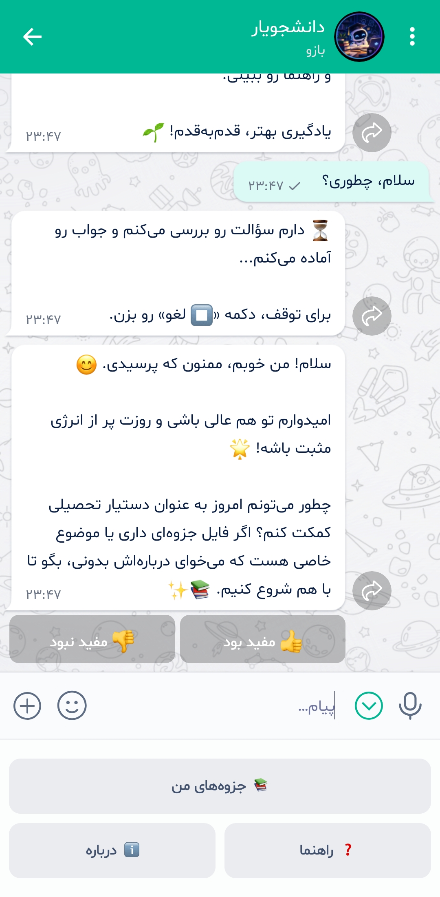
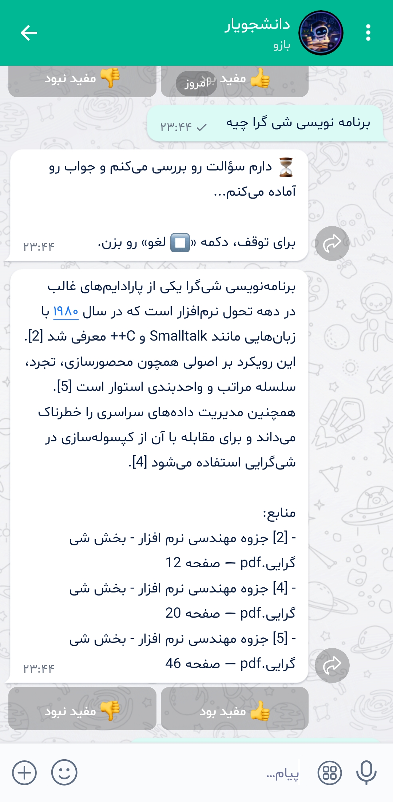
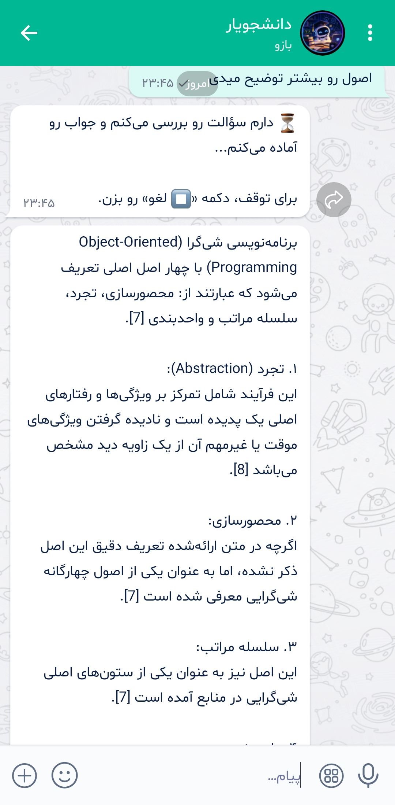
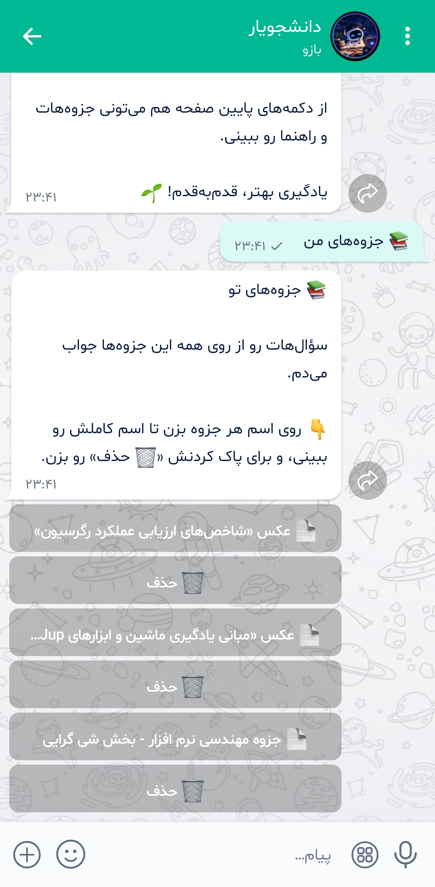
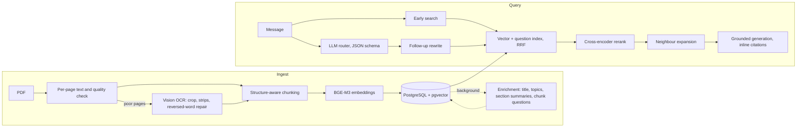

# Daneshjoyar — Persian Study Assistant (RAG) for Bale

**Local-first retrieval-augmented generation bot for [Bale](https://bale.ai) Messenger. Students upload PDFs (including scanned ones), ask questions in Persian, and get answers with inline citations and page references.**

`TypeScript` · `Node.js` · `PostgreSQL + pgvector` · `BGE-M3` · `bge-reranker-v2-m3` · `Ollama` · `Qwen 3.5 9B` · `llama.cpp` · `Vitest` · `Docker`

## Screenshots

<p align="center">
  
  
  
  
  
</p>

## Results

| Area | Result |
| --- | --- |
| Retrieval — 179 answerable questions, 8 documents, all-documents search | hit@1 **68% → 85%** with reranking (95% CI 80–91), hit@3 **96%**, answer page in context **97%**; held-out questions 82% hit@1 |
| End-to-end answers — 112 questions | **102 pass**, expected page in context 82/82, citations on topic 96%, unanswerable questions refused 25/30 (near-miss 18/23) |
| Router — 62 labelled messages, 24 sent by students | route **84%** (real messages 67%), route + retrieval mode 81% |
| OCR — scanned handout vs hand-typed reference | character error rate **37.0% → 4.0%** |
| Latency | 14.1 s median, 19.1 s p95 (retrieval + CPU rerank 6.7 s, generation 5.2 s at ~35 tokens/s, router 1.9 s); follow-ups +1.7 s for the rewrite |
| Whole-document summary | 21–44 s from stored section summaries vs 129 s – 31 min map-reduce |
| Tests | 610 unit, 39 integration (real Postgres), CI |

## Features

- Upload, list and delete PDFs; questions are answered from **all** of a student's documents at once.
- Grounded answers with numbered inline citations and a list of the cited pages only; refusals list none.
- Scanned and broken PDFs read by a local vision model, with progress updates in the chat.
- Follow-ups ("explain more") understood from the conversation; whole-document summaries.
- Buttons for navigation, cancel and 👍/👎 feedback; slow work runs in the background and is cancellable.

## Architecture



## Methods

**Retrieval**
- Dense search over chunks **and** LLM-generated "questions each chunk answers", fused with Reciprocal Rank Fusion: hit@10 96 → 99%, no question worse.
- Cross-encoder reranking (bge-reranker-v2-m3, CPU) of the top 10: hit@1 69 → 88%; falls back to vector order if the service is down.
- Neighbour-chunk expansion; only real hits are cited.
- Router (JSON-schema output) runs in parallel with a speculative search; a clear reranker score overrules a "chat" decision.
- Few-shot follow-up rewriting, with the previous answer's chunks competing in the rerank: follow-ups reaching the right context 25 → 75%.

**Ingestion and OCR**
- Hybrid extraction: text layer first, vision OCR only for empty / junk / split-letter pages (203-page upload: 63 min → 20 s).
- Phone scans: crop to the text, render at 1400 px, read in strips cut between lines (the vision encoder is quadratic in patches; one large image was 2× slower and crashed the Vulkan driver): CER 37.0 → 4.0%.
- Reversed-Persian-word detection and repair against a word-frequency list built from good text layers: CER 41.5 → 15.5%.
- Structure-aware chunking: slide-deck vs prose detection, repeated headers and page numbers stripped, titles kept as metadata. Per-page chunks beat cross-page / semantic chunking on long notes (hit@1 50% vs 21% / 36%).

**Generation**
- Sources first, question last, so exercise questions inside the notes are not answered.
- Numbered inline citations; only cited pages listed; refusal detection suppresses sources.
- Whole-document summaries from per-section summaries stored at upload (one LLM call); map-reduce for documents not yet enriched.
- Explicit `num_ctx` 8192 (Ollama's default 4096 silently truncated prompts), temperature 0.2, thinking off (chat 49 → 22 s), `keep_alive` to avoid ~10 s reloads.

**Background enrichment**
- Per document: title, summary, topics; per chunk: the questions it answers, embedded into the question index. One document at a time, yields the single GPU to answers, resumes after a restart.

**Reliability**
- Idempotent update processing (marked done only after the handler succeeds), per-chat cancellation, typed errors mapped to user messages, transactional ingestion with crash recovery, duplicate-upload detection, nightly backups.

## Evaluation

| Harness | Measures |
| --- | --- |
| `npm run eval` | hit@k, MRR, context coverage, wrong-document share, distance and reranker-score calibration; per type (exact term, paraphrase, multi-page, follow-up, standalone question after history, unanswerable), per tag (English, Latin-script Persian, typos, Arabic letters, tables, formulas) and a held-out row; every part of multi-concept questions in context; 95% bootstrap CIs and paired diffs against the previous run |
| `npm run eval:router` | route and mode accuracy per kind of message, confusion matrix, rewrite-rule check; includes messages students really sent, with their history; `--with-search` adds the early-search override |
| `npm run eval:answers` | cited page, expected page in context, wrong refusals, inline citations, key facts (accepted forms, formula-tolerant), language, refusals incl. near-miss questions; `--rescore` re-checks a saved run without the model |
| `npm run eval:citations` | hand-labelled citation pairs: how well a judge separates supported from unsupported claims |
| `npm run eval:ocr` | CER against text layers or hand-typed reference pages, per width / strip / crop / prompt / repair |
| `npm run benchmark` | per-stage latency p50 / p95, output tokens and tokens per second, follow-up and after-history samples; `--concurrency N` measures the queue |
| `npm run feedback` | real-usage report per week (chat share, rewrite share, refusals, time, 👍 share); 👎 answers become draft eval questions and router cases |

Runs are saved to `eval/results/`; the retrieval, router, answer and benchmark harnesses also compare each run with the previous one.

**Negative results (implemented, off by default):**

| Idea | Outcome |
| --- | --- |
| Hybrid keyword search (tsvector + RRF) | No page gained on 86 questions; BGE-M3 handles exact terms |
| Cross-page / semantic chunking, section expansion | Lower hit@1 / no effect |
| Context sentence + title in chunk embeddings | hit@1 85 → 82% |
| Reranker score cut-off for unanswerable questions | Scores overlap (kept 84/85 correct, rejected 2/6 negatives) |
| Document titles in the router prompt | Route unchanged, mode accuracy 97 → 91% |
| OCR of split-letter text layers | No gain on 21 questions at ~45 s/page |
| KV-cache quantisation | Skipped: Qwen 3.5's cache is 256 MB |
| Question normalisation (Arabic letters, zero-width marks) | No rank changed on 178 questions |
| Reranking 16 candidates instead of 10 | No page gained; slower rerank on the CPU |
| Looser candidate cut-off (0.65, 0.7) | One finglish page in, another out; in context 96% either way |
| Per-concept search for "X و Y" questions | Every part in context 15 → 14 of 17 |

## Testing

- **Unit (Vitest, 610):** pure logic (chunking, normalisation, page quality, word repair, context merging, citations) and mocked flows (update retry, cancel, OCR loop, enrichment priority, Ollama timeouts).
- **Integration (39, real Postgres + pgvector):** per-user isolation in search, deletion and the question index — verified by breaking the SQL filter and watching the tests fail; cascade deletes; atomic ingestion and enrichment.
- **CI:** type check (src, tests, scripts), coverage and integration tests on every push.

## Getting started

```bash
mkdir -p models && curl -L -o models/bge-reranker-v2-m3-Q8_0.gguf https://huggingface.co/gpustack/bge-reranker-v2-m3-GGUF/resolve/main/bge-reranker-v2-m3-Q8_0.gguf
docker compose up -d          # PostgreSQL + pgvector, reranker (CPU), nightly backup
npm install
npm run migrate:up
ollama pull qwen3.5:9b && ollama pull bge-m3
npm run dev                   # start the bot
```

```bash
npm test                      # unit tests
npm run test:integration      # database tests (creates daneshjohandbot_test)
npm run eval                  # also: eval:router, eval:answers, eval:ocr, benchmark, feedback
npm run enrich -- --all       # enrich documents uploaded before enrichment existed
npm run ingest -- <chatId> <absolute pdf paths>   # ingest without the bot
```

`.env`: `BALE_TOKEN`, `DATABASE_URL`, `LLM_URL`, `LLM_MODEL`, `EMBEDDING_MODEL`, `PORT`, Postgres credentials. Feature switches, and the measurement behind every default, are in `src/config.ts`.

### Docker

Ollama stays on the host (Docker Desktop cannot pass an AMD GPU to containers); the bot, PostgreSQL, reranker and backup run in Compose and reach Ollama at `host.docker.internal:11434` (set `OLLAMA_HOST=0.0.0.0` on Windows if needed).

```bash
docker compose --profile bot up -d --build
docker compose logs -f bot
```

Stop the bot container before `npm run dev`; two pollers would compete for updates.

### Backup and restore

The `backup` service dumps the database nightly at 03:00 (Tehran time) to `backups/`, keeping 14 days. The original PDFs in `uploads/` are only needed to re-ingest (for example after changing the embedding model).

```bash
docker compose exec -T postgres pg_restore --clean --if-exists -U "$POSTGRES_USER" -d "$POSTGRES_DB" < backups/daneshjo-YYYY-MM-DD.dump
```

## Project structure

```
src/
  main.ts            entry point: health endpoint + Bale polling
  config.ts          env vars and tunables, each with its measurement
  messages.ts        all user-facing text (Persian)
  bot/               polling, dispatcher, commands, buttons, enrichment worker, recovery
  chat/              message pipeline and PDF upload flow
  llm/               Ollama client, prompts, GPU priority
  rag/               router, ingest, OCR, chunking, enrichment, retrieval, reranking, rewrite, answers
  db/                one module per table; all SQL lives here
migrations/          node-pg-migrate schema migrations
scripts/             eval harnesses, benchmark, enrichment backfill, OCR word list, local ingestion
eval/                labelled question sets and OCR reference pages
tests/               unit tests; tests/integration/ runs against a real database
```

## Status

Actively developed personal project on retrieval-augmented generation, local vision OCR, and context-aware conversations for Persian study material.
