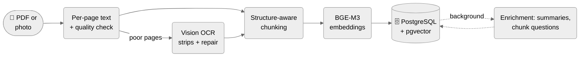
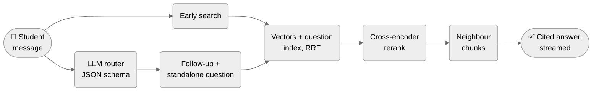

# Daneshjoyar — Persian Study Assistant (RAG) for Bale

**Local RAG bot for [Bale](https://bale.ai): students upload PDFs or scans, ask in Persian, get answers with inline citations and page numbers.**

`TypeScript` · `Node.js` · `PostgreSQL + pgvector` · `BGE-M3` · `bge-reranker-v2-m3` · `Ollama` · `Qwen 3.5 9B` · `llama.cpp` · `Vitest` · `Docker`

## Screenshots

<p align="center">
  
  
  
  
  
</p>

## Results

| Test | Result |
| --- | --- |
| Retrieval (178 questions, 8 docs) | hit@1 **67% → 84%** with reranking (CI 79–89) · hit@3 **94%** · answer page in context **96%** (96% with 12 distractor docs) |
| Answers (117 questions) | **112 pass** · unanswerable refused **30/30** · citations on topic **97%** · wrong refusals **0** · sentences supported by sources **89%** (gpt-oss:20b judge) |
| Router (62 messages, 24 real) | route + mode **100%** · follow-up detection **29/29** |
| OCR (scanned handout) | character error rate **37% → 4%** |
| Latency | first text **7.7 s** · full answer **10.6 s** median, **11.1 s** p95 · long-history routing **18.5 → 5.2 s** |
| Load (10 users at once) | **10/10** answered, no timeouts · 6.3 answers/min on one GPU |
| Summaries | **21–44 s** from stored section summaries (map-reduce: 129 s – 31 min) |
| Tests | **863** unit · **53** integration · CI |

## Features

- Questions answered from **all** of a student's documents
- Inline citations `[n]`; only cited pages listed
- Scanned PDFs and photos read by a vision model
- Follow-ups, summaries, "shorter / simpler / in 3 sentences"
- Questions about a handout itself (topic, author)
- Streamed answers · cancel · 👍/👎 feedback
- Fair GPU queue with place in line · 50 questions/day · long scans confirmed first
- `/deletemydata` · text kept 90 days

## Architecture

**Upload**



**Question**



## Methods

**Retrieval**
- Chunks + generated "questions each chunk answers", fused with RRF — hit@10 96 → 99%
- Cross-encoder rerank (bge-reranker-v2-m3, CPU) — hit@1 69 → 88%
- Router (JSON schema) in parallel with early search; follow-up + standalone question in one call — 9/29 → 29/29
- Neighbour-chunk expansion; rule-based routes for document questions and answer reshaping

**OCR and ingestion**
- Vision OCR only for poor pages — 203-page upload 63 min → 20 s
- Crop + 1400 px + strips cut between lines — CER 37 → 4%
- Reversed-Persian-word repair — CER 41.5 → 15.5%
- Per-page structure-aware chunking — hit@1 50% (cross-page 21%, semantic 36%)

**Generation**
- Sources first, question last (exercise questions in notes not answered)
- Stored section summaries for whole-document summaries (one call)
- `num_ctx` 8192 · thinking off (chat 49 → 22 s) · model preloaded
- Streaming by message edits (1.5 s, 429 back-off) · output caps · trimmed router history

**Reliability**
- Inbox + retry sweeper: no message lost on a crash
- Graceful shutdown (15 s grace, rest retried after restart)
- One GPU queue: answers > OCR > enrichment · busy limit 12
- Bale retries (429 `retry_after`, 5xx, network) · long polling
- `/ready` (DB, Ollama, reranker) · admin alerts · GPU-crash pause + retry
- Retention (7 / 90 days) · password-only DB · tested daily backups

## Tried and dropped

| Idea | Result |
| --- | --- |
| Hybrid keyword search | No page gained (86 questions) |
| Cross-page / semantic chunking, section expansion | Lower hit@1 / no effect |
| Context + title in chunk embeddings | hit@1 85 → 82% |
| Reranker cut-off for unanswerable questions | Scores overlap (2/6 negatives caught) |
| Document titles in the router prompt | Mode accuracy 97 → 91% |
| Rerank 16 candidates instead of 10 | No gain, slower |
| Per-concept search for "X و Y" | 15 → 14 of 17 |
| Question normalisation | No rank changed (178) |
| OCR of split-letter text layers | No gain, ~45 s/page |
| "Only citable sentences" prompt rule | 88.6 → 89.3%, noise |
| Answer cache · fixed greeting replies · chunk hashes | Rare repeats · felt artificial · no duplicates |

## Evaluation

| Command | Measures |
| --- | --- |
| `npm run eval` | hit@k, MRR, coverage, per type and tag, bootstrap CIs, diff vs previous run |
| `npm run eval:router` | route/mode accuracy, confusion matrix, real student messages |
| `npm run eval:answers` | citations, key facts, refusals; `--judge` checks each cited sentence |
| `npm run eval:ocr` | CER per width / strip / crop / prompt |
| `npm run benchmark` | latency per stage; `--concurrency N` load test |
| `npm run feedback` | weekly real-usage report; 👎 answers → new eval cases |

## Getting started

```bash
mkdir -p models && curl -L -o models/bge-reranker-v2-m3-Q8_0.gguf https://huggingface.co/gpustack/bge-reranker-v2-m3-GGUF/resolve/main/bge-reranker-v2-m3-Q8_0.gguf
docker compose up -d                  # PostgreSQL + pgvector, reranker, backup
npm install && npm run migrate:up
ollama pull qwen3.5:9b && ollama pull bge-m3
npm run dev                           # or: docker compose --profile bot up -d --build
npm test && npm run test:integration
```

- `.env`: `BALE_TOKEN`, `DATABASE_URL`, `LLM_URL`, `LLM_MODEL`, `EMBEDDING_MODEL`, `PORT`, Postgres credentials
- Optional: `ADMIN_CHAT_ID` · `DAILY_QUESTION_LIMIT` · `STREAM_MODE` · `LLM_KEEP_ALIVE` (tunables in `src/config.ts`)
- Ollama runs on the host (no AMD GPU in Docker Desktop); run only one bot at a time

**Restore a backup** (daily dump in `backups/`, kept 14 days):

```bash
docker compose exec -T postgres pg_restore --clean --if-exists -U "$POSTGRES_USER" -d "$POSTGRES_DB" < backups/daneshjo-YYYY-MM-DD.dump
```

## Project structure

```
src/
  bot/        polling, inbox, commands, buttons, workers
  chat/       message pipeline, uploads, streaming
  llm/        Ollama client, GPU queue, prompts
  rag/        router, OCR, chunking, retrieval, rerank, answers
  db/         one module per table (all SQL)
migrations/   schema migrations
scripts/      eval harnesses, benchmark, tools
eval/         labelled question sets
tests/        unit + integration (real Postgres)
```

## Status

Complete CV project — every change measured before and after. Runs locally (8 GB GPU), not publicly hosted.
